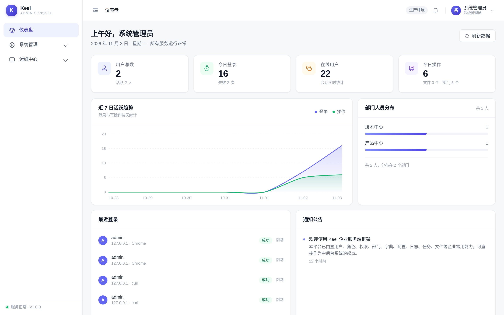

# Keel · 企业服务端基础框架

面向中小企业的 Go 服务端底座：**一套代码，三种形态**（单体 / 网关 / 领域服务）。
内置 RBAC 权限、数据权限、审计日志、定时任务、文件、字典、参数、公告、在线用户、系统监控，
自带管理控制台，编译即得单二进制，开箱可用。

```
┌──────────────────────────────────────────────────────────────┐
│  管理控制台（Vue 3 + Element Plus，构建后 //go:embed）         │
├──────────────────────────────────────────────────────────────┤
│  中间件  Trace → AccessLog → CORS → 安全头 → 限流 → 指标 → 审计│
├──────────────────────────────────────────────────────────────┤
│  auth  user  role  menu  dept  dict  config  notice           │
│  audit  job  file  dashboard  monitor                        │
├──────────────────────────────────────────────────────────────┤
│  platform  config · logger · database · cache · authn · authz │
│            crypto · idgen · httpx                            │
└──────────────────────────────────────────────────────────────┘
    Gin · GORM · Viper · Zap · go-redis · cron · excelize / Vue 3 · Vite · Element Plus
```



---

## 1. 为什么是它

| 维度 | 做法 | 收益 |
| --- | --- | --- |
| 资源占用 | 单二进制、纯 Go SQLite 驱动（零 CGO）、静态资源内嵌 | 空闲进程约 **26MB** 内存、**18** 个 goroutine |
| 请求速度 | 权限点/字典/参数短时缓存、批量填充避免 N+1、预编译语句 | 列表接口约 **0.45ms**（SQLite，单核） |
| 日志记录全 | Zap JSON 结构化日志 + 访问日志 + 慢请求 + 操作审计 + 登录日志 | 可落到 ELK/Loki，按 traceId 串联 |
| 业务覆盖 | 15 个业务模块、116 条 REST 接口、16 个管理页面、4 个内置任务执行器 | 覆盖中小企业通用后台需求 |
| 部署弹性 | `mono` / `gateway` / `service` 三种形态同一份代码 | 从 1 台机器平滑演进到微服务 |

**所有能力都基于成熟组件**：HTTP 用 Gin、ORM 用 GORM、配置用 Viper、日志用 Zap + lumberjack、
缓存用 go-redis、任务用 robfig/cron、JWT 用 golang-jwt、校验用 validator、Excel 用 excelize、
熔断用 sony/gobreaker、指标用 Prometheus client。框架只做**装配与约定**，不重复造轮子。

---

## 2. 30 秒跑起来

```bash
# 依赖：Go 1.21+，以及 pnpm（仅构建前端时用，运行时不需要 Node）
make build            # 先 pnpm build 产出 web/dist，再编译；产物 bin/keel 约 35MB
./bin/keel            # 默认读取 configs/config.yaml
```

打开 <http://localhost:9000>，默认账号 **admin / Admin@123456**（首次启动自动建表并写入演示数据）。

```bash
# 或直接运行（需先 make web 产出 dist，否则界面 404）
go run ./cmd/keel -config configs/config.yaml

# 三种形态
./bin/keel -mode mono       # 单体（默认）：一个进程装下全部
./bin/keel -mode gateway    # 网关：只转发，不连数据库
./bin/keel -mode service    # 领域服务：按 modules 裁剪接口
```

> 生产环境务必替换 `jwt.secret`（≥32 位）与 `security.internal_token`；
> `app.env=prod` 时框架会拒绝使用内置默认密钥启动。

---

## 3. 功能清单

| 分类 | 能力 |
| --- | --- |
| 认证 | 账号密码登录、图形验证码、JWT 双令牌（access 2h / refresh 7d）、令牌轮换、单点登录开关、登录失败锁定、两步验证（TOTP 扫码绑定、10 个一次性恢复码、管理员重置）、会话管理（踢下线） |
| 授权 | RBAC（用户-角色-菜单）、按钮级权限点（`system:user:create`）、通配符超级管理员、权限缓存 + 版本号整体失效 |
| 数据权限 | 全部 / 本部门 / 本部门及以下 / 仅本人，按角色取最大范围 |
| 组织 | 无限级部门树、负责人、成员数统计、防环校验 |
| 用户 | 增删改查、状态启停、重置密码、分配角色、手机号脱敏、Excel 导入 / 导出（含失败明细）、批量删除 |
| 会员 | 多等级配置（名称/权重/标识色/默认时长）、等级权益键值对、开通/续费/取消、永久或指定到期日、到期自动降级、用户侧权益展示、按会员状态筛选、权益中间件 |
| 对外接入 | API 密钥（服务端 / 客户端两类）、scope 与 RBAC 同构、IP 网段白名单、独立速率与日配额、一键轮换、签发时仅回显一次明文 |
| 角色 | 数据范围、菜单授权、内置角色保护 |
| 菜单 | 目录/菜单/按钮三级、导航树、权限点自动收集、拖拽排序字段 |
| 字典 | 字典类型 + 字典项、前端 `PublicData` 一次性拉取、10 分钟缓存 |
| 参数 | 分组键值配置、公开参数（登录页可读）、敏感值加密展示 |
| 公告 | 通知/公告/预警、置顶、发布状态 |
| 消息 | 站内信收件箱、未读数轮询、已读回执、全员/角色/指定用户投递、撤回、公告发布自动同步 |
| 审计 | 登录日志、操作日志（请求/响应体脱敏截断）、在线用户、批量异步落库、自动清理 |
| 任务 | cron 表达式、跳过并发执行、启用停用、手动触发、执行日志、防重入、Redis 分布式锁（多实例只跑一份） |
| 文件 | 上传（扩展名白名单 + 大小限制 + SHA256 + 按日期分目录）、下载、列表、删除；本地磁盘与 MinIO/OSS/S3/COS 自动切换 |
| 监控 | 运行时/内存/GC/协程、数据库连接池、缓存与存储类型、路由清单、`/healthz` `/readyz` `/metrics` |
| 依赖装配 | 数据库 SQLite→MySQL/PostgreSQL、缓存本地→Redis、存储本地→对象存储、邮件 SMTP、限流与任务锁随缓存自动切换，全部按配置自动激活 |
| 无状态 | 多实例校验（`runtime.stateless`）、共享会话、分布式限流与任务锁、对象存储，可直接横向扩容 |
| 框架 | 统一响应、统一错误码、参数校验中文化、分页/排序/过滤白名单、限流、CORS、安全响应头、优雅停机、配置热更新、进程内事件总线 |

---

## 4. 目录结构

```
.
├── cmd/keel/                # 入口：-config / -mode / -version
├── configs/                 # mono / gateway / service 三套配置样例
├── internal/
│   ├── bootstrap/           # 装配：配置 → 日志 → 数据库 → 缓存 → 模块 → 路由 → 生命周期
│   ├── router/              # 路由注册，按模块拆分（auth/system/ops），支持模块裁剪
│   ├── middleware/          # trace/日志/恢复/CORS/限流/审计/指标/鉴权鉴权点
│   ├── micro/               # 网关：前缀路由 + 服务发现 + 重试 + 熔断
│   ├── model/               # GORM 模型（用户/角色/菜单/部门/字典/参数/日志/任务/文件/消息）
│   ├── modules/             # 15 个业务模块，统一 service.go + handler.go
│   └── platform/            # 基础设施：config logger database cache authn authz crypto idgen httpx
├── pkg/                     # 通用库：errs response query utils event client discovery version
├── web/                     # 管理控制台：Vue 3 + TS + Element Plus + Vite
│   ├── src/                 #   api / components / layouts / pages / router / stores / styles
│   ├── dist/                #   构建产物，由 //go:embed all:dist 打入二进制
│   └── embed.go
├── deploy/                  # Dockerfile 由根目录提供；compose 与 K8s 清单在 deploy/
├── docs/                    # 架构、配置、API、部署、微服务、二次开发
└── test/                    # 端到端集成测试与基准测试
```

---

## 5. 一个请求的生命周期

```
Client
  → Recovery（panic 兜底）
  → Trace（生成/复用 X-Trace-Id，写入日志与响应头）
  → AccessLog（方法/路径/状态/耗时/字节/IP/UA，慢请求 Warn）
  → CORS / SecurityHeaders / BodyLimit / RateLimit / Metrics
  → Auth（解析 JWT → 校验会话 → 加载权限点缓存）
  → RequirePerm（权限点匹配，超级管理员放行）
  → Audit（非 GET 请求记录操作日志，敏感字段脱敏）
  → Handler → Service（数据权限过滤 / 事务 / 缓存）
  → response.OK/PageOK（{code,message,data,traceId}）
```

---

## 6. 常用命令

```bash
make build      # 编译当前平台
make build-all  # 交叉编译 linux/darwin/windows
make test       # 全量测试（含 -race）
make bench      # 基准测试
make dev        # debug 模式运行
make docker     # 构建镜像
make compose    # MySQL + Redis + Keel 一键编排
make help       # 查看全部目标
```

---

## 7. 性能参考

测试机：AMD EPYC 9K65（32 vCPU）、SQLite（WAL）、单进程。`go test -bench . -benchmem ./test/`

| 场景 | 单核延迟 | 32 并发吞吐 |
| --- | --- | --- |
| `GET /healthz`（含 DB/Cache 探活） | 95 µs | ~10.5k req/s |
| `GET /api/v1/users`（鉴权 + RBAC + 分页） | 452 µs | ~2.3k req/s |
| `GET /api/v1/auth/profile`（会话校验 + 菜单树） | 884 µs | ~0.5k req/s |

瓶颈在 SQLite 的串行写/页缓存，切换 MySQL/PostgreSQL 后可线性扩展；
单实例静态资源与业务同进程，无需 Node 构建链，冷启动约 120ms。

---

## 8. 文档

| 文档 | 内容 |
| --- | --- |
| [docs/architecture.md](docs/architecture.md) | 分层设计、请求链路、鉴权模型、缓存与数据权限 |
| [docs/config.md](docs/config.md) | 全量配置项、环境变量映射、热更新 |
| [docs/api.md](docs/api.md) | 统一响应、错误码、分页/过滤/排序约定、接口清单 |
| [docs/microservices.md](docs/microservices.md) | 三种形态、服务发现、网关、服务间调用 |
| [docs/deploy.md](docs/deploy.md) | 二进制/Docker/Compose/K8s 部署、可观测、备份、扩容 |
| [docs/development.md](docs/development.md) | 新增业务模块的完整步骤、分支模型与提交规范 |

---

## 9. 安全基线

- 密码 bcrypt（cost 10）存储，强度策略可配（长度 / 字母+数字 / 四类字符）
- 登录失败计数 + 账号锁定，图形验证码可开启
- 两步验证：TOTP（兼容 Google / Microsoft / Duo / Bitwarden 等）、恢复码、管理员重置
- JWT HS256 + 会话表双校验，登出/踢下线立即失效
- 审计日志对 `password` / `token` / `secret` 等字段自动脱敏
- 列表接口手机号脱敏；敏感配置项加密存储、展示为 `******`
- 上传文件扩展名白名单 + 大小限制 + 随机文件名，杜绝路径穿越
- `prod` 环境强制 ≥32 位 JWT 密钥，禁止默认密钥启动
- 全部 SQL 经 GORM 参数化；排序/过滤字段走白名单，`LIKE` 通配符转义

---

## 10. 许可

内部项目模板，可自由用于商业项目；如需开源请补充 LICENSE。
